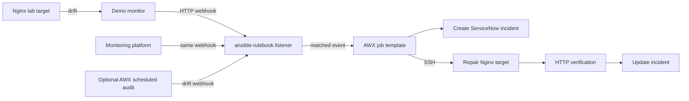

# Event-driven incident remediation lab

Standalone lab project at the repository root. It uses a generic monitoring webhook, an Ansible Rulebook listener, the AWX instance in `enterprise-ops-orchestrator/`, and a disposable Nginx target. An AWX job creates a ServiceNow incident, repairs the target, verifies it, and updates the incident.

## Flow



The local demo monitor is only a stand-in for a real monitoring product. A real product can POST to the same listener after its payload is mapped to the event fields below.

## Components

- `target/`: disposable Nginx + SSH container. The only remediation target in this lab.
- `monitor/`: small standard-library Python poller that emits an alert when the page contains the drift marker.
- `rulebooks/monitoring-alerts.yml`: webhook source and rule that launches the AWX job.
- `playbooks/remediate_demo_alert.yml`: creates/correlates a ServiceNow incident, restores the demo page, checks recovery, and updates incident work notes/state.
- `inventory/hosts.yml`: example AWX inventory for the container SSH endpoint.
- `samples/error-alert.json`: event body for testing the listener without waiting for the monitor.
- `scripts/`: helper to create a lab SSH key and a script that introduces reversible demo drift.

## Requirements

- Docker Desktop with Kubernetes enabled; AWX running from `enterprise-ops-orchestrator/`.
- Python 3.9+ and Java JDK 17+ in WSL, plus `ansible-rulebook`, Ansible, `ansible-runner`, and the `ansible.eda` collection.
- An AWX API token and an AWX machine credential for the disposable container.
- For incident creation, a ServiceNow PDI and a least-privilege API user configured in an AWX custom credential. Never place tokens, passwords, or private keys in Git.

## 1. Build and start the isolated target

In WSL:

```bash
cd ~/pivanta.org/event-driven-remediation
bash scripts/prepare-lab-key.sh
docker compose up --build -d
```

Import `secrets/ansible_ed25519` into an AWX Machine credential. The helper creates `secrets/`, which is ignored by Git. In AWX, create an inventory with the example host in `inventory/hosts.yml`, or copy its variables into the AWX inventory. The target address is `host.docker.internal:2222`; verify reachability from an AWX job before proceeding. The disposable web page is available at `http://localhost:8081` from WSL.

The target SSH account has passwordless sudo inside this disposable container to allow Ansible to replace the demo page. Do not reuse this image or credential on a real host.

## 2. Configure AWX

Use the AWX instance deployed by `enterprise-ops-orchestrator`, but create a **new AWX Project** for this lab. The existing AWX Project named `enterprise-ops-orchestrator` syncs the GitHub repository of the same name on branch `dev`; it cannot see this sibling folder on your WSL disk. `AWX GitOps Configuration` is for controller configuration and should not be used as the lab playbook Project.

To preserve this folder as its own project, publish its contents to a Git repository AWX can sync, then create a new Project in the same AWX organization. The recommended branch for this lab is `dev`; set the AWX Project SCM branch to `dev` and attach a GitHub SCM credential that has read access to this repository. If this repository's root contains the contents of this folder, choose `playbooks/remediate_demo_alert.yml` as the playbook. If you instead commit this directory under `event-driven-remediation/` inside the existing `enterprise-ops-orchestrator` GitHub repository, sync that existing Project and choose `event-driven-remediation/playbooks/remediate_demo_alert.yml`.

Create a job template:

- Name: `Incident Remediation - Demo Nginx`
- Playbook: the path relative to the synced repository root (see above)
- Inventory: the one-host disposable lab inventory
- Machine credential: the key generated above, with privilege escalation enabled
- Variables: enable **Prompt on launch** for extra variables so `ansible_eda.event` can be supplied.

For ServiceNow, create an AWX custom credential type with these fields:

```yaml
fields:
  - id: instance_url
    type: string
    label: ServiceNow instance URL
  - id: username
    type: string
    label: API username
  - id: password
    type: string
    label: API password
    secret: true
required: [instance_url, username, password]
```

Set its environment injector to:

```yaml
env:
  SNOW_INSTANCE_URL: '{{ instance_url }}'
  SNOW_USERNAME: '{{ username }}'
  SNOW_PASSWORD: '{{ password }}'
```

Create a credential of that type using your PDI URL and integration account, then attach it to the job template. The playbook uses the ServiceNow Table API at `/api/now/table/incident`; confirm your PDI's field choices and allowed incident state values before using it.

The job only accepts alerts whose `target` equals `demo-nginx`. This is an allow-list, not a general remote-host remediation mechanism.

## 3. Run the event listener

Install the dependencies in a dedicated virtual environment. From this directory:

```bash
python3 -m venv .venv
source .venv/bin/activate
python -m pip install ansible ansible-rulebook ansible-runner
ansible-galaxy collection install -r requirements.yml
```

On Ubuntu/WSL, install Java and Python's venv support first if needed: `sudo apt install openjdk-17-jdk python3-venv python3-pip`. Current Rulebook installation requires Java 17 or newer ([official installation guide](https://docs.ansible.com/projects/rulebook/en/latest/installation.html)).

Create an AWX API token in AWX. In the same WSL shell, export it (do not commit it) and run:

```bash
export AWX_TOKEN='paste-token-here'
ansible-rulebook \
  --inventory localhost, \
  --rulebook rulebooks/monitoring-alerts.yml \
  --controller-url http://127.0.0.1:8080/api/v2 \
  --controller-token "$AWX_TOKEN"
```

Keep the AWX port-forward from `./start-awx.sh` running in another terminal. The webhook listener binds to port 5000 and is unauthenticated for this local-only demo. Do not expose it to the internet.

## 4. Exercise the event flow

Open a second WSL terminal. First introduce reversible drift into the disposable container:

```bash
bash scripts/introduce-drift.sh
```

Run the monitor in another terminal:

```bash
python monitor/demo_monitor.py
```

Or post the sample event directly to test the rule without the monitor:

```bash
curl -X POST http://127.0.0.1:5000/endpoint \
  -H 'Content-Type: application/json' \
  --data @samples/error-alert.json
```

The expected event keys are `payload.severity`, `payload.status`, `payload.target`, `payload.alertname`, and `payload.event_id`. The rule matches `severity: error` and `status: firing`; it passes the event to AWX, where the playbook validates it again.

## 5. ServiceNow behavior

The playbook reuses an active incident by `dedup_key` (or the `alertname:target` fallback) before creating one, writes the AWX remediation result to work notes, and only requests resolution after the target responds with the expected page content. On repair/verification failure it records the failure and leaves the incident open. A real monitoring source should provide a stable deduplication key for an alert episode. ServiceNow field availability, API ACLs, and state/close-code values can differ by PDI configuration, so validate these against your instance.

If ServiceNow credentials are not attached, the job fails before making target changes. This avoids silently remediating without the requested incident audit trail.

## 6. AWX schedule and real monitoring integration

An AWX schedule runs periodic jobs; it is not a persistent event listener. This repository includes `playbooks/audit_and_emit_event.yml` for periodic polling. Create a second AWX job template named `Scheduled Demo Baseline Audit`, select `playbooks/audit_and_emit_event.yml`, and use an inventory that permits the localhost play. From the template's **Schedules** tab, add a schedule such as every five minutes. The AWX execution environment must be able to reach `host.docker.internal:8081` and the Rulebook listener at `host.docker.internal:5000`; verify those routes from an AWX job before relying on the schedule.

For event-based operation, keep `ansible-rulebook` running as a managed process/service and configure the monitoring tool to POST alerts to its `/endpoint`. A production monitoring tool can send to the same webhook after its payload is mapped to the expected fields. Use a protected, managed Event-Driven Ansible environment or service for a persistent listener; this unauthenticated local webhook is for the isolated demo only.

## Operations and cleanup

- Stop the demo monitor with Ctrl+C and the rulebook listener with Ctrl+C.
- Stop/remove only the disposable target with `docker compose down` from this folder.
- Do not run cleanup against the AWX namespace for routine lab shutdown.
- Rotate the AWX token and PDI password if they are accidentally exposed.

## Important platform note

This is community AWX plus a separately run `ansible-rulebook` listener, not the Red Hat Ansible Automation Platform Event-Driven Ansible Controller. Rulebook's `run_job_template` action needs a Controller API URL/token; the AWX job template must allow launch-time variables. See [Rulebook actions](https://docs.ansible.com/projects/rulebook/en/latest/actions.html#run-job-template), [event sources](https://ansible.readthedocs.io/projects/rulebook/en/stable/sources.html), and [AWX job templates](https://docs.ansible.com/projects/awx/en/24.6.1/quickstart/create_job.html).
