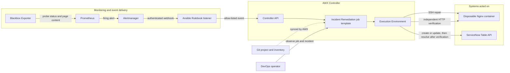
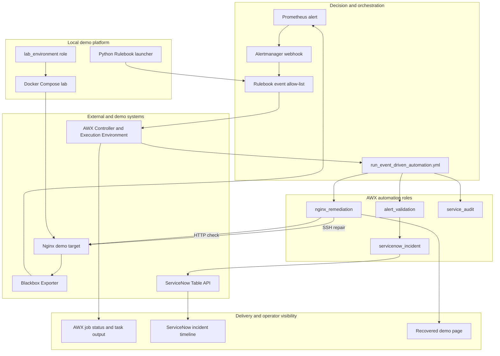
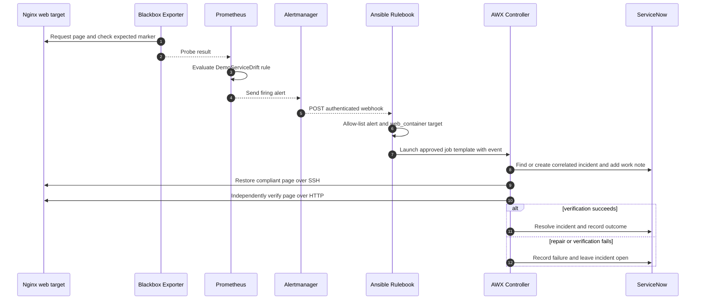

# Event-Driven Remediation Lab

A disposable end-to-end lab showing how an alert can launch a controlled AWX
remediation, create or update a ServiceNow incident, verify recovery, and record
the result. This README is the complete project guide: architecture, components,
AWX configuration, setup, testing, and troubleshooting.

## Contents

1. [Overview](#overview)
2. [High-level design](#high-level-design)
3. [Logical architecture](#logical-architecture)
4. [End-to-end event flow](#end-to-end-event-flow)
5. [Repository layout](#repository-layout)
6. [Prerequisites and AWX setup](#prerequisites-and-awx-controller-configuration)
7. [Prepare and start the lab](#1-prepare-and-start-the-disposable-environment)
8. [Start the event listener](#2-start-the-local-event-listener)
9. [Run the automatic test](#3-run-a-full-automatic-test)
10. [Direct webhook test](#4-optional-test-the-webhook-without-waiting-for-prometheus)
11. [ServiceNow, audit, troubleshooting, and cleanup](#servicenow-and-retry-behavior)

## Overview

The lab demonstrates a controlled recovery workflow: monitoring detects a
broken demo web page, an event rule decides whether it is allowed to trigger
automation, AWX repairs a disposable Nginx target, and ServiceNow records the
incident and outcome. Recovery is independently checked before the incident
is resolved.

The simple mental model is: **Prometheus detects, Alertmanager delivers, the
rulebook dispatches, and AWX repairs and verifies.**

## High-level design



Blackbox Exporter requests the page and checks the expected content. Prometheus
evaluates the probe and fires `DemoServiceDrift` if it fails. Alertmanager
forwards that alert to the authenticated local rulebook listener. The rulebook
checks the event and approved target before launching the AWX template.

## Logical architecture



The root playbook is the single Ansible entry point. For local environment
operations, pass `lab_environment_action`; those actions invoke the reusable
`lab_environment` role on the workstation. AWX launches the same playbook
without that variable, selecting event remediation when `ansible_eda.event` is
present or the optional audit when it is absent.

## End-to-end event flow



## Repository layout

| Path | Purpose |
| --- | --- |
| `environment/` | Complete Docker lab environment: Compose file, Nginx target image, Prometheus, Blackbox Exporter, and Alertmanager configuration. |
| `rulebooks/monitoring-alerts.yml` | Authenticated webhook source, event checks, and AWX launch action. |
| `run_event_driven_automation.yml` | The single playbook entry point. It runs the local lab role when `lab_environment_action` is set; otherwise it runs AWX event remediation or the scheduled audit. |
| `roles/alert_validation/` | Normalizes and allow-lists the incoming event before making changes. |
| `roles/servicenow_incident/` | Finds or creates the correlated incident, records work notes, and resolves or updates it after remediation. |
| `roles/nginx_remediation/` | Repairs the disposable web container and independently verifies the page before resolving the incident. |
| `roles/service_audit/` | Checks the baseline and emits an authenticated event when the scheduled audit detects drift. |
| `roles/lab_environment/` | Local lab operations in YAML with a Python Ansible module: create secrets and sample data, start/stop Docker, and introduce or restore demo drift. |
| `inventory/hosts.ini` | Example INI-format SSH inventory for the disposable target. |
| `rulebooks/run_rulebook.py` | Python launcher for the long-running local webhook listener. |
| `rulebooks/error-alert.json` | Sample event payload for direct webhook testing. |

### Ansible role and Python layout

The project-root event orchestrator calls focused roles for the AWX work. Each
role follows Ansible's standard layout, with task files and defaults; the
ServiceNow role also has separate task files for resolution and failure
handling. The local `lab_environment` role includes a small Python module under
`library/` for preparing secrets and controlling the disposable Docker lab.
Python also runs the local `ansible-rulebook` listener.

## Where each component runs

| Component | Runs in | Purpose |
| --- | --- | --- |
| Nginx target | Local Docker container | Disposable web service with SSH enabled so the AWX job can restore its page. |
| Blackbox Exporter, Prometheus, Alertmanager | Local Docker containers | Probe the page, evaluate the alert, and send the webhook. |
| Ansible Rulebook | Python virtual environment on the workstation | Receives the authenticated webhook and calls the AWX Controller API. |
| AWX Controller | AWX installation | Stores the project, inventory, credentials, job template, and job history. |
| Remediation playbook and roles | AWX Execution Environment container | Connects to ServiceNow and the Nginx target, repairs the page, and verifies recovery. |
| `lab_environment` role | Workstation, run locally | Prepares keys and tokens and starts, stops, or changes the local Docker lab. It is not run inside the AWX job. |

The Docker Compose containers are the monitored application and monitoring
stack. AWX launches a separate job in its configured Execution Environment.
That job reaches the target over SSH at `host.docker.internal:2222` and checks
the page over HTTP at `http://host.docker.internal:8081/` from the AWX execution
environment.

## Prerequisites and AWX Controller configuration

- Docker Desktop with its Kubernetes cluster running, for the local AWX lab.
- Python 3.12 and Java 17 or newer in WSL for the Ansible Rulebook listener.
- Docker Compose and `ssh-keygen` available in WSL for the local environment role.
- The AWX API token, lab Machine credential, and ServiceNow credential.
- An AWX Project synced from the Git repository and branch containing this
  project. Its checkout must be reachable by the AWX job's Execution Environment.

Configure the following AWX resources before running the automatic flow:

| AWX resource | Configuration |
| --- | --- |
| Project | Sync the Git repository and branch containing this project. Confirm the sync succeeds. |
| Inventory and host | Add group `demo_targets` and host `web_container`. Configure SSH host `host.docker.internal`, port `2222`, user `ansible`, and Python interpreter `/usr/bin/python3`. |
| Machine credential | Add the private key generated at `secrets/ansible_ed25519`. Enable privilege escalation on the remediation template. |
| ServiceNow credential | Store the developer-instance URL, API-only username, and password. Never put these values in Git or job extra variables. |
| Execution Environment | Select an EE with `ansible-core`, Python, and an SSH client. This project uses built-in Ansible modules for its AWX tasks. |
| Job template | Use the synced project, inventory, Machine and ServiceNow credentials, and this project's `run_event_driven_automation.yml`. If AWX syncs a parent repository, include the `event-driven-remediation/` prefix in the playbook path. Enable prompting for extra variables so Rulebook can pass `ansible_eda.event`. |
| Rulebook launch target | Match the template name `Incident Remediation - Demo Nginx` and organization `devops-org` configured in `rulebooks/monitoring-alerts.yml`. |

The inventory host must match the `web_container` name in
`inventory/hosts.ini` and belong to `demo_targets`. The Docker Compose service
name is `demo-nginx`; it is the container name used by the local lab. The
Execution Environment must be able to resolve and reach `host.docker.internal`
on ports `2222` and `8081`; on another machine or container platform, replace
that hostname with a reachable address.

The `lab_environment` role runs locally from WSL, where it can access your
Docker daemon and `ssh-keygen`. Do not run that role as an AWX job.

### What happens inside the AWX job

1. The rulebook launches the named job template and passes the alert event as
   extra variables.
2. `alert_validation` checks that the event is firing, is an error, and names
   the allow-listed `web_container` target.
3. `servicenow_incident` looks for an active incident with the same event
   correlation key. It reuses the matching incident or creates one, then adds a
   work note containing the AWX job ID.
4. AWX connects to `web_container` over SSH and restores the known-good HTML
   file from the synced project.
5. The playbook independently requests the page over HTTP and confirms HTTP
   200 plus the expected page marker.
6. On successful verification, the ServiceNow role records the resolution. If
   repair or verification fails, it records the failed task and leaves the
   incident open; AWX reports the job as failed.

For a scheduled audit, AWX runs the same entry playbook without an EDA event.
The `service_audit` role checks the target and sends an authenticated event if
the baseline is missing. The schedule is optional and disabled by default.

## 1. Prepare and start the disposable environment

Run these commands from the project root in WSL:

```bash
python3 -m venv .venv
source .venv/bin/activate
python -m pip install --upgrade pip
python -m pip install -r requirements.txt
ansible-playbook run_event_driven_automation.yml -e lab_environment_action=prepare
ansible-playbook run_event_driven_automation.yml -e lab_environment_action=start
curl -fsS http://127.0.0.1:8081/ | grep -F 'Event-Driven Remediation Service - healthy'
```

The `lab_environment` role creates an SSH key and webhook token under ignored
`secrets/`, renders the sample webhook event, and starts the Docker environment.
Existing key/token files are preserved. The host `secrets/` directory stays
private (`0700`); the webhook token file is readable inside its read-only
Alertmanager mount so the non-root container process can authenticate requests.
Import `secrets/ansible_ed25519` into the AWX Machine credential and keep the
private key private. The `environment/`
folder contains the complete Docker Compose lab: Nginx,
Blackbox Exporter, Prometheus, and Alertmanager together. Open Prometheus at
`http://localhost:9090/targets` and Alertmanager at `http://localhost:9093/`.

The role runs on your WSL workstation, where Docker and `ssh-keygen` are
available. Its Python module invokes the Docker CLI with argument lists and
does not use a shell script. The AWX remediation job continues to use the
separate `alert_validation`, `servicenow_incident`, and `nginx_remediation`
roles.

The target publishes HTTP on `127.0.0.1:8081` and SSH on port `2222` so the
local AWX job can reach it as `host.docker.internal:2222`. It grants passwordless
sudo only inside this disposable container. Do not reuse this image or its
credential on a real host.

The baseline page identifies the container as a healthy Event-Driven
Remediation service. The `drift` action replaces it with
`environment/target/drift.html`, which explains that an alert-driven repair is
expected. Prometheus detects the changed content, and the AWX job restores
`environment/target/index.html`; its independent HTTP check looks for the
healthy page marker before the incident can be resolved.

## 2. Start the local event listener

The custom Python website poller has been removed. Prometheus monitors the
Nginx page. Python is used by Ansible and the local `ansible-rulebook` listener.

Keep your AWX Controller port-forward running in another terminal, then open
AWX at `http://localhost:8080`. This lab assumes the controller and required
job template have already been deployed and configured.

Start the Rulebook listener:

```bash
python rulebooks/run_rulebook.py
```

It prompts silently for the AWX API token and loads the local webhook token. The
default Controller URL is `http://127.0.0.1:8080`; this is the host/base URL,
not a URL ending in `/api/v2`. Set `EDA_CONTROLLER_URL` only if your AWX
port-forward uses a different address.

The listener requires the shared bearer token. It listens on the WSL host
interface so the Alertmanager container can reach it at
`host.docker.internal:5000`; do not expose this demo listener to the public
internet.

## 3. Run a full automatic test

Prometheus now checks the page continuously, so no custom Python monitor needs
to run. In another terminal, introduce reversible drift:

```bash
ansible-playbook run_event_driven_automation.yml -e lab_environment_action=drift
```

Open Prometheus **Alerts** and watch `DemoServiceDrift` fire. Alertmanager sends
it to the Rulebook listener, which launches `Incident Remediation - Demo Nginx`.
After the job completes, check:

```bash
curl -fsS http://127.0.0.1:8081/ | grep -F 'Event-Driven Remediation Service - healthy'
```

Then verify the AWX job succeeded and the ServiceNow incident has detection and
completion work notes and a resolved state. If any repair or verification step
fails, the playbook should leave the incident open with a failure note.

## 4. Optional: test the webhook without waiting for Prometheus

With the listener running, post the sample event using the local token:

```bash
read -rsp 'Webhook bearer token: ' EDA_WEBHOOK_TOKEN
echo
curl --fail-with-body --silent --show-error \
  -X POST http://127.0.0.1:5000/endpoint \
  -H "Authorization: Bearer ${EDA_WEBHOOK_TOKEN}" \
  -H 'Content-Type: application/json' \
  --data @rulebooks/error-alert.json
unset EDA_WEBHOOK_TOKEN
```

This sample has a fixed `event_id`, so repeated posts reuse the correlated
incident. For a fresh incident, change the ID in a copied event payload.

## ServiceNow and retry behavior

The playbook correlates active incidents using `dedup_key`, falling back to
`alertname:target`. A production monitor should provide a stable key for one
alert episode and a distinct key after the issue clears and fires again. The
playbook writes AWX's job ID in its detection work note. ServiceNow field
requirements, ACLs, and valid resolution values can vary by instance; test
changes in the disposable PDI first.

The rulebook accepts only the expected firing Alertmanager event and target;
the playbook independently checks the same allow-listed target before making
changes. These checks reduce accidental execution but do not replace access
controls, network restrictions, or credential protection.

## Optional scheduled audit

The AWX template `Scheduled Demo Baseline Audit` uses the same entry playbook,
checks the HTTP marker, and posts an event when drift is found. Its schedule is disabled by default. To
enable it, start the Rulebook listener and attach an AWX credential that injects
`EDA_WEBHOOK_TOKEN` into the template's execution environment. The scheduled
playbook fails clearly if drift is found but the token is missing.

## Troubleshooting and cleanup

- **Rulebook cannot connect to AWX:** start the EOR port-forward and use the
  base URL `http://127.0.0.1:8080`, without `/api/v2`.
- **Webhook returns unauthorized:** verify Alertmanager and the listener use
  the same value from `secrets/webhook-token`.
- **Prometheus does not show `DemoServiceDrift`:** open
  `http://localhost:9090/targets`, confirm `nginx-web-check` is up, then check
  `http://localhost:9090/alerts` after introducing drift.
- **Alertmanager cannot reach Rulebook:** confirm the Rulebook listener runs on
  port 5000 and `secrets/webhook-token` exists.
- **AWX SSH failure:** verify the AWX Machine credential contains the matching
  `secrets/ansible_ed25519` key and the inventory target is `host.docker.internal`
  on port `2222`.

Stop the Rulebook listener with Ctrl+C. Stop the demo and monitoring containers with:

```bash
ansible-playbook run_event_driven_automation.yml -e lab_environment_action=stop
```

Use `lab_environment_action=restore` to restore the compliant page without
stopping the environment. Use `lab_environment_action=sample` to regenerate
only `rulebooks/error-alert.json`.

This project uses community AWX, Prometheus/Alertmanager, and a separately run
`ansible-rulebook` listener; it is not the Red Hat Ansible Automation Platform Event-Driven
Ansible Controller. See the official
[Rulebook webhook source documentation](https://docs.ansible.com/projects/rulebook/en/latest/sources.html),
[Rulebook variable documentation](https://docs.ansible.com/projects/rulebook/en/latest/variables.html),
and [AWX launch action documentation](https://docs.ansible.com/projects/rulebook/en/latest/actions.html#run-job-template).

