# Automation Reports: Automation Health, CMDB Health, and Opportunities

Read-only reporting built with Ansible and run as an AWX job. It answers three operational questions:

1. **Automation Health:** are recent AWX jobs succeeding, what failed, and which templates have not run?
2. **CMDB Health:** how complete and current are server configuration items (CIs)?
3. **Opportunity Miner:** which repeated ServiceNow work types may be candidates for automation?

The AWX entry point is `healthcheck_reports.yml`. It runs the `automation-health`, `cmdb-health`, and `opportunity-miner` roles on localhost. Each role prints a concise summary in AWX and renders a detailed HTML report. The roles read APIs only; they do not update AWX or ServiceNow. AWX injects credentials at run time; secrets are not stored here.

---
 
## Table of contents
 
1. [Overview](#1-overview)
2. [Business value](#2-business-value)
3. [Scope](#3-scope)
4. [Reports at a glance](#4-reports-at-a-glance)
5. [High-Level Design (HLD)](#5-high-level-design-hld)
6. [Low-Level Design (LLD)](#6-low-level-design-lld)
7. [Metric definitions](#7-metric-definitions)
8. [Configuration reference](#8-configuration-reference)
9. [Credentials, access and security](#9-credentials-access-and-security)
10. [Running it](#10-running-it)
11. [Reading the output](#11-reading-the-output)
12. [Performance and sizing](#12-performance-and-sizing)
13. [Testing](#13-testing)
14. [Troubleshooting](#14-troubleshooting)
15. [Known limitations and assumptions](#15-known-limitations-and-assumptions)
16. [Example results (dev snapshot)](#16-example-results-dev-snapshot)
17. [Roadmap](#17-roadmap)
18. [Glossary](#18-glossary)
- [Appendix A: Related, Opportunity Miner](#appendix-a-related-opportunity-miner)
- [Appendix B: File index](#appendix-b-file-index)
 
---
 
## 1. Overview
 
This project collects bounded data **read-only** from the AWX Controller API and ServiceNow Table API, calculates metrics in role-local Ansible modules, prints concise summaries in AWX job output, and renders one detailed HTML report per selected role. It does not send email.

| Item | Value |
|---|---|
| Technology | Ansible playbook, three roles, and role-local Python metric modules |
| Runs on | AWX job template in an Execution Environment, against `localhost` |
| Reads from | AWX Controller API and ServiceNow Table API |
| Writes to | HTML report files under `/tmp/healthcheck-reports` in the execution environment; no AWX or ServiceNow records are changed |
| Schedule | Launch manually; scheduling is an AWX configuration decision |
| AWX configuration | AWX Project, inventory, credentials, and job template configured in your AWX Controller |
 
---
 
## 2. Business value
 
| Audience | Benefit |
|---|---|
| Automation team | See job success, failure details, runtime metrics, and templates with no recent runs. |
| Service managers | Review automation reliability, server-CI data quality, and repeated-work candidates. |
| Audit and quality | Review a read-only operational snapshot in AWX job history. |
| CMDB owners | Identify stale or incomplete records for human review. |
 
---
 
## 3. Scope
 
| In scope | Out of scope (today) |
|---|---|
| AWX job and template health, with failure reasons and run-time metrics | Fixing or relaunching failed jobs |
| Optional ServiceNow ticket matching for automation health; separate repeated-work report | Changing, resolving, or deleting ServiceNow records |
| Server CI checks: stale, missing ownership, duplicate names, field fill | CMDB relationship checks and automatic cleanup |
| AWX summaries and role-generated HTML reports | PDF, email, dashboards, and historical trend storage |
| Developer/test AWX and ServiceNow instances | Production changes without review |
 
---
 
## 4. Reports at a glance
 
| | Automation Health | CMDB Health | Opportunity Miner |
|---|---|---|---|
| Question | Are AWX jobs and templates healthy? | Is server CI data complete and current? | Which repeated work may be automatable? |
| Role | `automation-health` | `cmdb-health` | `opportunity-miner` |
| Metric module | `health_metrics` | `cmdb_metrics` | `opportunity_metrics` |
| Data | AWX jobs, templates, failed-job events; optional ServiceNow sources | `cmdb_ci_server` by default | `sc_task`, `change_task`, `incident` by default |
| Key output | Job counts, success rate, failure reasons, runtime, unused templates | Stale, missing owner, duplicate names, field fill | Repeated descriptions and handler classification |
| Switch | `run_automation_health` | `run_cmdb_health` | `run_opportunity_miner` |
| Default bounds | 30 days; 200 rows/page; 10 pages | 2,000 CIs; 500 rows/page | 90 days; up to 1,000 rows/table |
 
---
 
## 5. High-Level Design (HLD)
 
### 5.1 System context
 
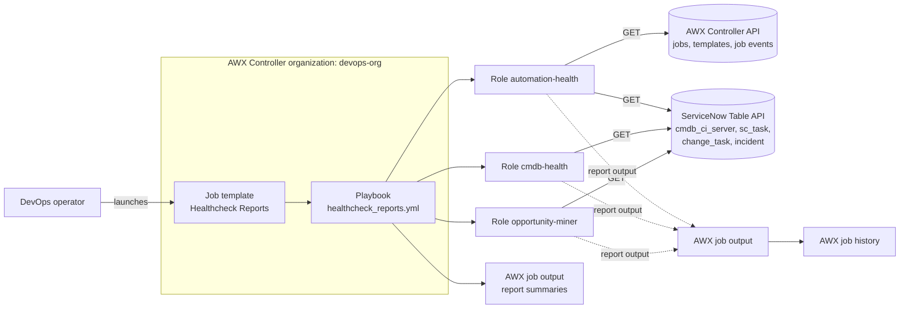
 
### 5.2 Logical architecture
 
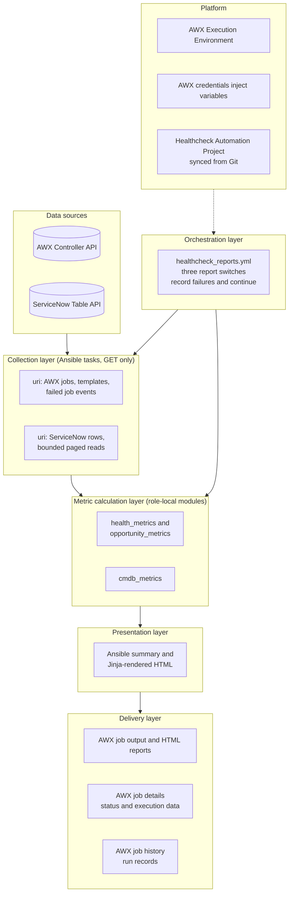
 
### 5.3 One run, end to end (Automation Health)
 
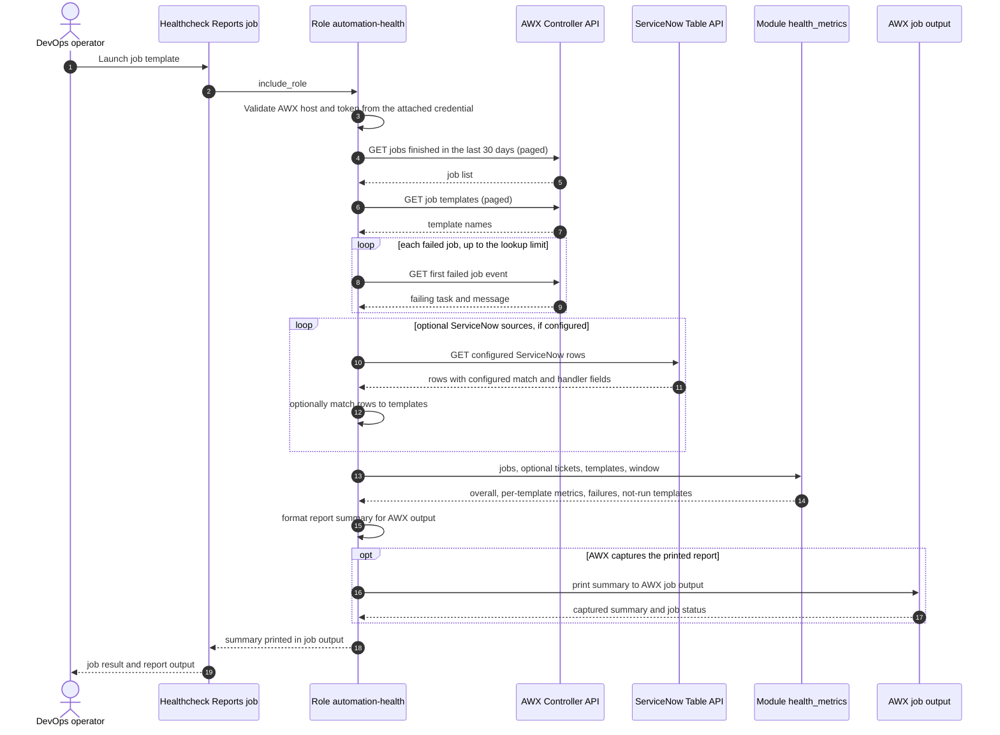
 
### 5.4 Delivery and deployment
 
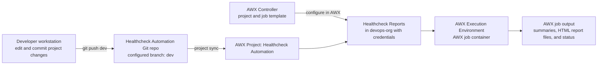
 
### 5.5 Design principles
 
| Principle | How it shows in the current implementation |
|---|---|
| **Read-only** | The API tasks use GET requests; no records or attachments are written. |
| **Credentials stay in AWX** | Tokens and passwords are injected by AWX credentials rather than committed to Git. |
| **Bounded reads** | Page sizes, page limits, lookback windows, and maximum records limit API requests. |
| **Independent reports** | Each selected role is wrapped in block/rescue; other reports can still run if one fails. |
| **Clear job status** | The entry playbook records role failures and fails the overall job after the selected roles have run. |
| **Configurable** | Table names, fields, thresholds, users, and limits are role defaults that can be overridden. |
 
---
 
## 6. Low-Level Design (LLD)
 
### 6.1 Repository layout
 
```text
healthcheck-automation/
├── README.md
├── healthcheck_reports.yml              AWX entry playbook for all three reports
├── .gitignore                           ignores virtualenvs and secret files
└── roles/
    ├── automation-health/
    │   ├── defaults/main.yml            AWX and optional ticket-matching defaults
    │   ├── tasks/main.yml               AWX API reads, HTML render, and summary
    │   ├── tasks/snow_source.yml        optional ServiceNow matching
    │   ├── library/health_metrics.py    automation-health calculations
    │   └── templates/report.html.j2     automation-health HTML report
    ├── cmdb-health/
    │   ├── defaults/main.yml            CMDB settings
    │   ├── tasks/main.yml               CI reads, HTML render, and summary
    │   ├── library/cmdb_metrics.py     CMDB calculations
    │   └── templates/report.html.j2    CMDB HTML report
    └── opportunity-miner/
        ├── defaults/main.yml            work-table/classification settings
        ├── tasks/main.yml               ServiceNow reads, HTML render, and summary
        ├── library/opportunity_metrics.py repeated-work calculations
        └── templates/report.html.j2    opportunity HTML report
```

Configure an AWX Project for this repository, a localhost inventory, read-only credentials, and a job template that runs `healthcheck_reports.yml`.
 
### 6.2 Entry playbook control flow
 
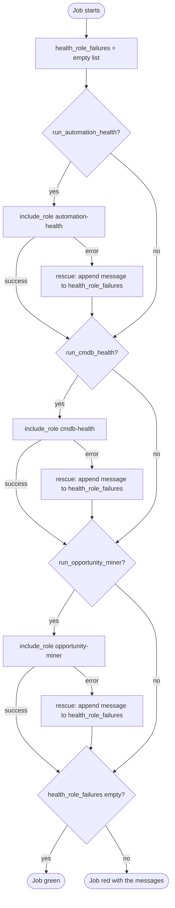
 
The three report switches default to `true` in `healthcheck_reports.yml`. Set `run_automation_health`, `run_cmdb_health`, or `run_opportunity_miner` to `false` in an approved AWX extra-variable prompt to skip a report. Secret values belong in AWX credentials, not extra variables.
 
### 6.3 Role `automation-health`
 
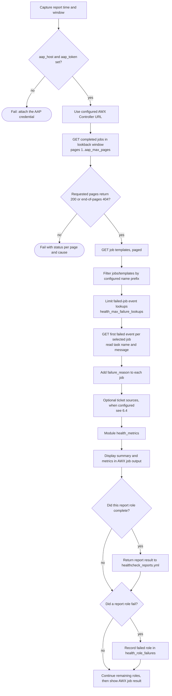
 
| Phase | Tasks | Notes |
|---|---|---|
| Guard | Require `aap_host` and `aap_token` | Injected by the AWX API credential. |
| AWX collection | Read jobs, templates, and selected failed-job events | Bounded pagination; authenticated task output is hidden. |
| Optional ServiceNow collection | Read configured sources via `snow_source.yml` | Disabled by default; sources are configured per instance. |
| Compute | `health_metrics` | Calculates metrics from collected records. |
| Output | AWX job stdout | Summaries and selected details appear in the job Output tab. |

### 6.4 ServiceNow sources (manual fallback)
 
The optional matching path can associate ServiceNow work rows with AWX templates to enrich automation-health reporting. It is disabled by default (`health_include_snow: false`) and has no configured sources by default. The Opportunity Miner is a separate report that groups recent ServiceNow work by short description.
 
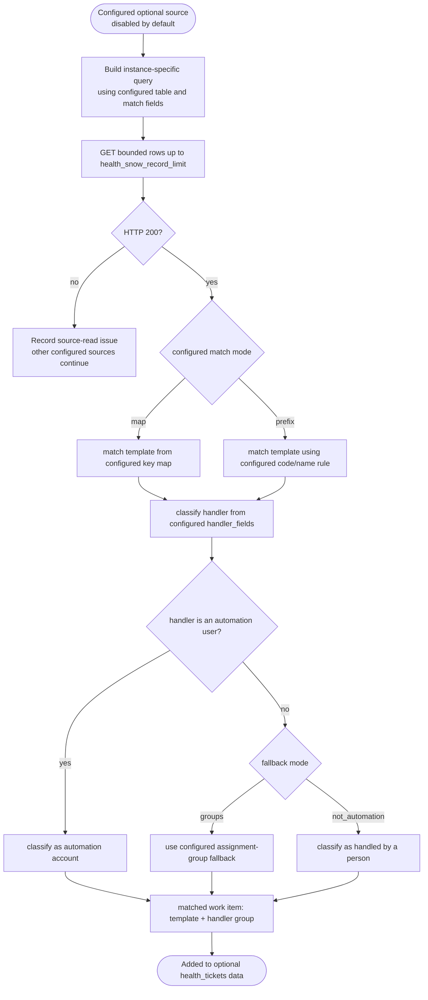
 
No ServiceNow matching source is enabled in the current defaults. To enable it, configure `health_snow_sources` for the actual tables, match keys, maps/codes, handler fields, and manual groups in your instance, then set `health_include_snow: true`.
 
### 6.5 Module `health_metrics`
 
**Interface**
 
| Input | Type | Meaning |
|---|---|---|
| `jobs` | list of dict | `name`, `status`, `finished`, `elapsed`, `failure_reason` or `job_explanation` |
| `tickets` | list of dict | `automation` (template name), `assignment_group` |
| `templates` | list of string | every template name, to find those with no run |
| `window_days`, `as_of` | int, string | period and reference time |
| `manual_groups` | list of string | groups that mean "fell back to manual" |
| `manual_minutes`, `default_manual_minutes` | dict, int | minutes a person needs per run, for the hours estimate |
| `top_failures` | int | how many failure reasons to return |
 
| Output | Content |
|---|---|
| `overall` | runs, successful, failed, success rate, templates active, templates not run, hours saved |
| `templates` | one row per template: runs, success rate, median and p95 runtime, last run, tickets, fallback, hours saved |
| `failure_reasons` | top reasons with counts |
| `not_run` | templates with no job in the window |
 
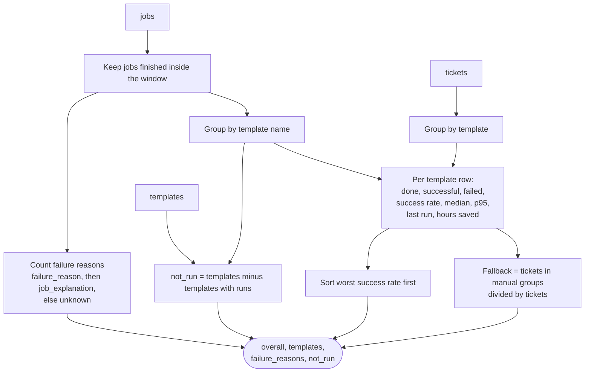
 
### 6.6 Role `cmdb-health`
 
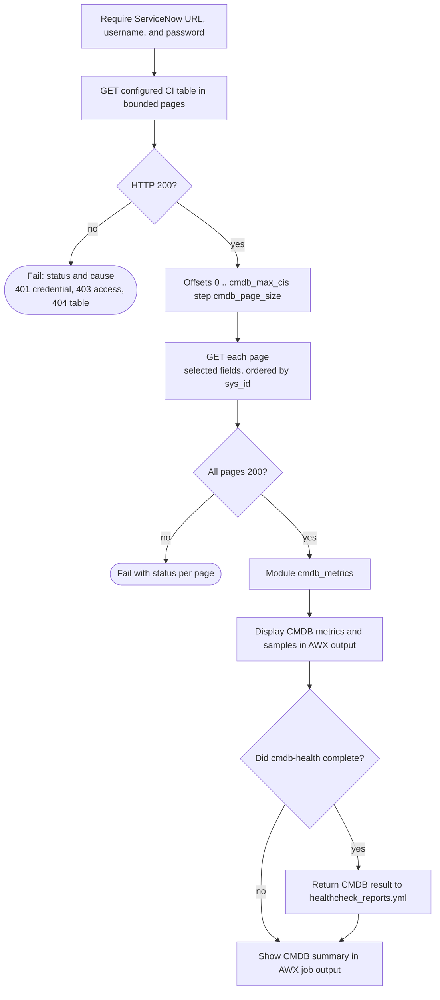
 
### 6.7 Module `cmdb_metrics`
 
**Rules applied to every CI**
 
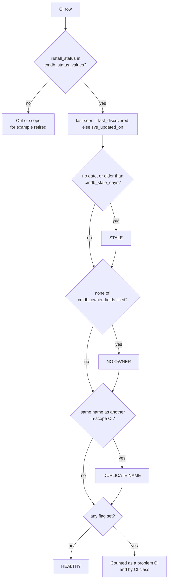
 
| Input | Meaning |
|---|---|
| `cis` | list of CI rows |
| `fields` | requested fields, for the fill-rate table |
| `in_scope_status_values` | install status values that mean "live" (empty = all) |
| `stale_field`, `stale_fallback_field`, `stale_days` | how "last seen" is read and the limit |
| `owner_fields` | CI has an owner when any of these is filled |
| `list_limit` | rows per problem list |
 
| Output | Content |
|---|---|
| `overall` | total read, in scope, out of scope, stale, no owner, duplicate CIs, duplicate names, healthy, health percent |
| `stale`, `stale_names` | stale CIs, oldest first, with days since last seen |
| `no_owner`, `duplicates` | lists (duplicates grouped by name with a count) |
| `problems_by_class` | CIs with at least one problem per CI class |
| `field_fill`, `status_counts` | data-quality tables to judge whether the checks can be trusted |
 
### 6.8 Report output
 
Each role renders its calculated result through `roles/<role>/templates/report.html.j2` and writes the report to `{{ health_report_output_dir }}`. The default path is `/tmp/healthcheck-reports` inside the job's Execution Environment. The role also prints a concise summary and report path in AWX output. The directory is local to the job container; use a mounted persistent directory or artifact-publishing step if reports must remain available after the job ends.
 
### 6.9 Email delivery (not implemented)
 
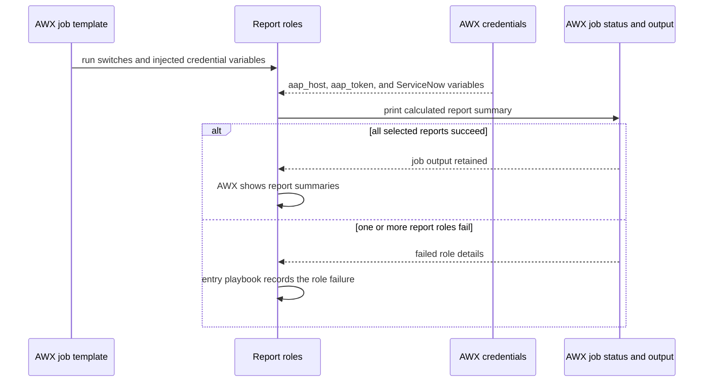
 
Email delivery is not implemented. Each role creates a detailed HTML file in `/tmp/healthcheck-reports` inside the execution environment and also prints a concise summary in AWX job output. The files are local to that job container unless you configure a persistent artifact destination.
 
### 6.10 Error-handling pattern
 
Each role validates its required credentials, performs API reads, and checks responses before calculating metrics. The top-level playbook catches role failures so other selected reports can run, then fails the overall job if a report failed.
 
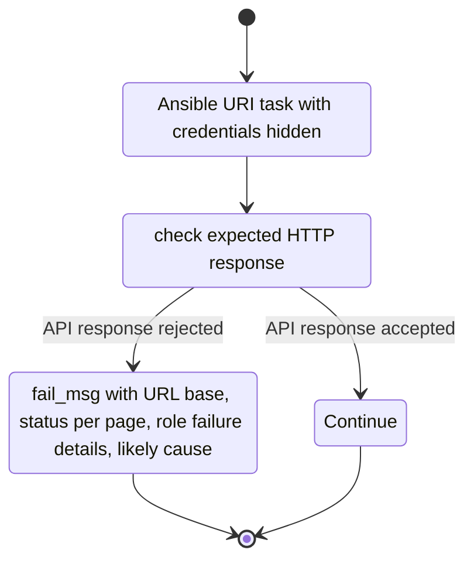
 
The authenticated API request tasks use `no_log: true` so secrets and raw responses are not exposed in AWX stdout. Failure messages are designed to identify the likely endpoint, permission, or TLS issue without printing credential values.
 
### 6.11 Data model
 
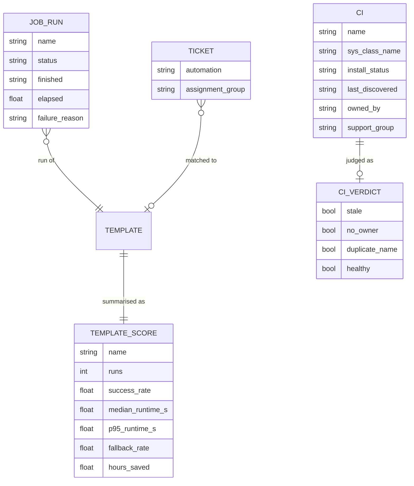
 
### 6.12 Credentials and variables
 
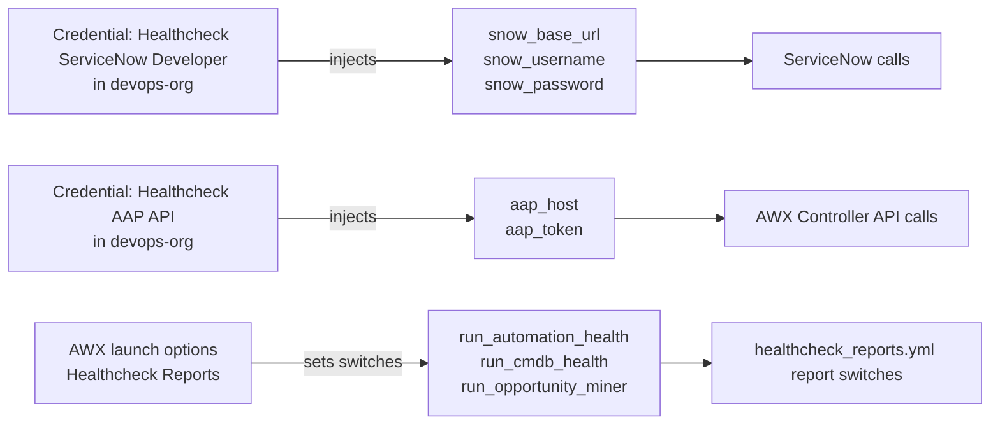
 
---
 
## 7. Metric definitions

### Automation Health

| Metric | Definition |
|---|---|
| Run | A finished AWX job in the selected window with a reported status. |
| Success rate | Successful jobs divided by successful, failed, and error jobs; canceled jobs are excluded from the rate. |
| Median and p95 runtime | Percentiles calculated from available elapsed values for each template. |
| Failure reason | The task name and available message from the first failed job event; job explanation is used as a fallback. |
| Not run | A job template with no matching completed job in the selected window. |
| Hours saved | An estimate based on successful run counts and configured minutes; defaults to zero minutes unless configured. |

### CMDB Health

| Metric | Definition |
|---|---|
| In scope | CI whose `install_status` is included in `cmdb_status_values` (default `1`). |
| Stale | In-scope CI whose `last_discovered`, or fallback `sys_updated_on`, is older than `cmdb_stale_days`; a missing date is treated as stale. |
| No owner | In-scope CI with all configured owner fields empty. |
| Duplicate name | In-scope CIs whose names match case-insensitively. Confirm duplicates before making data changes. |
| Healthy | In-scope CI with a discovery date within the threshold, an owner, and a unique name. |

### Opportunity Miner

The role groups recent ServiceNow rows by `short_description` by default, then classifies closed work using the configured handler fields and automation usernames. Candidate groups meet `opp_min_volume` and are limited by `opp_top_n`. It is a report for human review, not an automation approval or savings guarantee.

## 8. Configuration reference

All settings are defined in each role's `defaults/main.yml`. Secret values are supplied by AWX credentials; use extra variables only for non-secret overrides.

### Playbook

| Variable | Default | Meaning |
|---|---|---|
| `run_automation_health` | `true` | Run automation health. |
| `run_cmdb_health` | `true` | Run CMDB health. |
| `run_opportunity_miner` | `true` | Run the opportunity report. |

### Automation Health

| Variable | Default | Meaning |
|---|---:|---|
| `aap_host`, `aap_token` | empty | AWX Controller URL and read-only token; injected by credential. |
| `aap_api_prefix` | `/api/v2` | Controller API prefix. |
| `health_window_days` | `30` | Job-history lookback. |
| `aap_page_size`, `aap_max_pages` | `200`, `10` | Pagination bounds for jobs/templates. |
| `aap_validate_certs` | `true` | Validate Controller TLS. |
| `health_template_name_prefix` | empty | Optional template-name prefix filter. |
| `health_max_failure_lookups` | `100` | Maximum failed-job event lookups. |
| `health_top_failures` | `8` | Failure reasons to display. |
| `health_include_snow` | `false` | Enable optional ServiceNow matching. |
| `health_snow_sources` | `[]` | Optional table/matching definitions; configure for your instance. |
| `health_snow_record_limit` | `1000` | Maximum rows per configured source. |
| `health_automation_users` | `[]` | Accounts classified as automation in optional matching. |

### CMDB Health

| Variable | Default | Meaning |
|---|---:|---|
| `snow_base_url`, `snow_username`, `snow_password` | empty | ServiceNow endpoint and credentials injected by AWX. |
| `snow_validate_certs` | `true` | Validate ServiceNow TLS. |
| `cmdb_table` | `cmdb_ci_server` | Table to inspect. |
| `cmdb_query` | empty | Optional encoded query. |
| `cmdb_page_size`, `cmdb_max_cis` | `500`, `2000` | Page size and total-record cap. |
| `cmdb_stale_days` | `90` | Staleness threshold. |
| `cmdb_status_values` | `["1"]` | Install statuses considered in scope. |
| `cmdb_owner_fields` | `[owned_by, support_group]` | Fields used by the ownership check. |
| `cmdb_fields` | role defaults | Fields requested from ServiceNow. |
| `cmdb_list_limit` | `25` | Maximum examples in output. |

### Opportunity Miner

| Variable | Default | Meaning |
|---|---|---|
| `opp_tables` | `[sc_task, change_task, incident]` | ServiceNow tables to inspect. |
| `opp_max_tasks_per_table` | `1000` | Maximum rows read from each table. |
| `opp_window_days` | `90` | Lookback period. |
| `opp_automation_users` | `[awx_remediation]` | Usernames classified as automation. |
| `opp_handler_fields` | `[closed_by, assigned_to]` | Handler fields inspected. |
| `opp_min_volume`, `opp_top_n` | `3`, `15` | Candidate threshold and output limit. |
| `opp_default_minutes` | `0` | Assumed effort; zero means no savings estimate by default. |
| `opp_unknown_as_system` | `false` | Whether a missing handler counts as system work. |

## 9. Credentials, access and security
 
| Topic | Current design |
|---|---|
| Writes | The roles use read-only GET requests and do not update AWX or ServiceNow records. |
| ServiceNow account | Use an account with read access only to the tables and fields needed for these reports. |
| AWX token | Use a read-only API token with access to job history, job events, and templates. |
| Secrets | Inject `aap_token`, `snow_username`, and `snow_password` through AWX credentials. Never commit them to Git. |
| Certificates | TLS validation defaults to `true` for AWX and ServiceNow. Configure the EE trust store for your instance CA rather than disabling validation. |
| Output data | Job output may include template names, CI names, and work descriptions; restrict access and sharing accordingly. |
| Production | Validate permissions, fields, thresholds, and data handling with the AWX and ServiceNow owners before production use. |
 
---
 
## 10. Running it
 
### 10.1 AWX project setup
 
1. Push the portfolio repository to the Git branch used by your AWX Project.
2. In AWX, create a Project pointing to the portfolio repository and select the branch to sync.
3. Create or select a localhost inventory and attach read-only AWX API and ServiceNow credentials to the job template.
4. Create a job template named `Healthcheck Reports` that uses this Project, the localhost inventory, and the `healthcheck-automation/healthcheck_reports.yml` playbook path.
5. Sync the Project, launch the template, then inspect its Output tab. The role summaries appear in AWX; detailed HTML reports are written inside the execution environment to `/tmp/healthcheck-reports` unless you configure a persistent artifact location.

The portfolio repository contains the report playbook and roles under `healthcheck-automation/`. This project assumes an AWX Controller and a suitable Execution Environment are already available.
 
### 10.2 Extra variables cheat sheet
 
| Goal | Extra variables |
|---|---|
| Run all reports | None; all switches default to `true`. |
| Only CMDB health | Set `run_automation_health: false` and `run_opportunity_miner: false`. |
| Only automation health | Set `run_cmdb_health: false` and `run_opportunity_miner: false`. |
| Only opportunity miner | Set `run_automation_health: false` and `run_cmdb_health: false`. |
| Reduce CMDB read size | Set `cmdb_max_cis: 300` and `cmdb_page_size: 100`. |
| Disable optional ticket matching | `health_include_snow: false` (already the default). |

Do not pass passwords or API tokens as extra variables; attach credentials to the AWX job template.
 
### 10.3 Locally

AWX is the intended run path because credentials and the Execution Environment are configured there. This repository does not currently include a maintained local test harness or CI workflow. For development, install the needed Ansible runtime and collections, provide the same variables securely, and run against developer/test instances. Never commit secrets or place them in shared command history.

### 10.4 First-time repository setup
 
1. Push the portfolio repository to the Git repository configured in the AWX Project.
2. Configure the AWX Project, credentials, inventory, and job template in your AWX Controller.
3. Attach read-only credentials to the `Healthcheck Reports` template.
4. Sync the project, launch the job, and compare the summaries with sample data from the developer/test instances. The playbook is read-only; there is no email or write-mode switch.
 
---
 
## 11. Reading the output
 
| Where | What | Use |
|---|---|---|
| AWX job Output tab | Automation health summary, template metrics, and failure reasons | Review job and template health. |
| AWX job Output tab | CMDB totals, field-fill metrics, and sample CI names | Identify records for manual investigation. |
| AWX job Output tab | Opportunity totals and candidate work descriptions | Review recurring work before proposing automation. |
| Execution environment `/tmp/healthcheck-reports` | Detailed HTML reports for each selected role | Open or copy reports while the job container is available; configure persistent artifact storage if they must outlive the job. |
| AWX job Details | status, timing, project revision, and execution environment | Confirm what ran and which version was checked out. |
 
Validate the ServiceNow install-status values and ownership fields against several real records before interpreting the CMDB percentages.
 
---
 
## 12. Performance and sizing
 
| Item | Behaviour |
|---|---|
| AWX calls | Jobs and templates are read in pages; failed-job event lookups are capped by `health_max_failure_lookups`. |
| CMDB calls | `cmdb_page_size` and `cmdb_max_cis` bound the rows requested. |
| Work-item calls | `opp_max_tasks_per_table` caps rows read from each configured table. |
| Runtime | Depends on API response time, lookback window, page limits, and number of failed jobs. No current benchmark is published. |
| Truncation | AWX pagination is checked; the role fails if more pages remain beyond `aap_max_pages`. CMDB and opportunity reports are intentionally capped. |
 
---
 
## 13. Testing
 
Automated tests and CI are not currently present in this repository. Validate changes with a run against developer/test services and verify the output. A future contribution should add sanitized API fixtures and unit tests for the role-local metric modules.
 
---
 
## 14. Troubleshooting
 
| Symptom | Likely cause | Fix |
|---|---|---|
| Missing `aap_host` or `aap_token` | AWX credential missing or injecting different variable names | Attach the credential that supplies these exact names. |
| AWX API 401/403 | expired token or insufficient permissions | Refresh the token and verify read access to jobs, events, and templates. |
| AWX API 404 | incorrect base URL or API prefix | Check `aap_host` and `aap_api_prefix` (`/api/v2` by default). |
| ServiceNow 401/403 | invalid credentials or table permissions | Verify the developer instance, account, and table read roles. |
| ServiceNow table/field error | table or requested field is unavailable | Check the table and adjust role defaults to match the instance. |
| Results seem incomplete | record/page cap or filters exclude records | Review the relevant limits and filters; increase caps if appropriate. |
| One report fails while others ran | isolated role failure | Review that role's task output; the final job status reports the failed role. |
| AWX Project or template missing | Project or job template has not been configured in AWX | Create the Project and job template in the AWX Controller, then sync the Project. |
 
---
 
## 15. Known limitations and assumptions
 
| # | Limitation | Effect |
|---|---|---|
| 1 | CMDB and task reads are capped | totals can describe only the configured sample. |
| 2 | Optional AWX-to-ServiceNow matching is disabled by default | manual-fallback metrics need source configuration before they are meaningful. |
| 3 | The opportunity miner groups by short description | wording differences may split similar work; matching wording may merge unrelated work. |
| 4 | Handler attribution depends on ServiceNow reference values and configured usernames | validate sample classifications before drawing conclusions. |
| 5 | Stale and owner checks use configurable default fields/statuses | adjust these to your ServiceNow data model. |
| 6 | No historical storage | each job is a snapshot; the project does not provide trend dashboards. |
| 7 | HTML files are written inside the job container; there is no built-in artifact publishing | configure persistent storage or artifact publishing if reports must outlive the job. |
| 8 | No automatic remediation or record updates | humans must review results and take any follow-up action. |
| 9 | No test suite or CI workflow yet | changes need manual validation in a developer/test environment. |
 
---
 
## 16. Example results (dev snapshot)
 
No fixed sample numbers are published here because results depend on the current AWX and ServiceNow developer-instance data. Use the counts and summaries from the latest AWX job run as the current snapshot.
 
---
 
## 17. Roadmap
 
| Next | Why |
|---|---|
| Add unit tests and sanitized API fixtures | verify metric behavior on repeatable data |
| Publish JSON/CSV artifacts | make report data easier to retain and compare |
| Configure and validate optional ServiceNow matching | enrich AWX failures with confirmed ticket context |
| Improve work-type normalization | group similar ServiceNow descriptions more reliably |
| Add trends or a dashboard | compare snapshots over time |
| Consider a schedule | run periodically after owners approve the cadence and data handling |
| Consider write/remediation workflows separately | preserve human review and explicit controls |
 
---
 
## 18. Glossary
 
| Term | Meaning |
|---|---|
| AAP | Ansible Automation Platform (controller) |
| Job template | a saved way to run a playbook in AAP |
| Execution environment (EE) | the container image a job runs in |
| Module | a small Ansible component written in Python. Here it only counts. |
| Role | a reusable group of Ansible tasks |
| CI | configuration item, a record in the CMDB |
| Live CI | a CI whose install status means in use |
| Stale | not seen for longer than the limit |
| Manual fallback | work the automation did not finish and a person handled |
| p95 | the run time that 95 of 100 runs stay under |
| Read-only report | API records are read and summarized; no source-system changes are made. |
| SC-Task | service catalog task, table `sc_task` |
| Change task | task of a change request, table `change_task` |
 
---
 
## Appendix A: Related, Opportunity Miner
 
The `opportunity-miner` role runs from `healthcheck_reports.yml` when `run_opportunity_miner` is true. By default it reads recent rows from `sc_task`, `change_task`, and `incident`, groups them by `short_description`, classifies handlers using configured fields/users, and prints candidate work types in AWX output while rendering an HTML report. It does not launch or create automations.
 
## Appendix B: File index
 
| File | Purpose |
|---|---|
| `healthcheck_reports.yml` | AWX entry playbook with report switches and failure collection |
| `roles/automation-health/defaults/main.yml` | AWX API and optional ticket-matching defaults |
| `roles/automation-health/tasks/main.yml` | AWX collection, metric calculation, and output |
| `roles/automation-health/tasks/snow_source.yml` | optional ServiceNow source matching |
| `roles/automation-health/library/health_metrics.py` | automation-health metric module |
| `roles/automation-health/templates/report.html.j2` | Automation health HTML report template |
| `roles/cmdb-health/` | ServiceNow CMDB collection and metric role |
| `roles/cmdb-health/library/cmdb_metrics.py` | CMDB metric module |
| `roles/cmdb-health/templates/report.html.j2` | CMDB HTML report template |
| `roles/opportunity-miner/` | repeated-work collection and metric role |
| `roles/opportunity-miner/library/opportunity_metrics.py` | opportunity metric module |
| `roles/opportunity-miner/templates/report.html.j2` | Opportunity HTML report template |
| `health_report_output_dir` | defaults to `/tmp/healthcheck-reports`; set it to a mounted persistent directory if HTML files must survive the AWX job |
